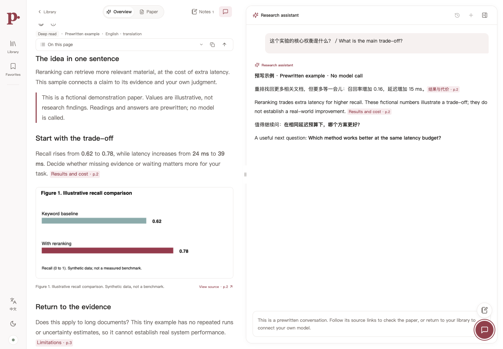

# Paper Workbench

**English** | [简体中文](README.zh-CN.md)

Read a paper, ask questions about it, and keep your notes in one local workspace.

Paper Workbench combines a continuously scrolling PDF reader, AI reading overviews, source-linked conversations, and a personal paper library. Bring your own model API, or use an existing Codex / Claude session to write results back into the reader.

Inspired by alphaXiv’s reading experience, this is an independent project—not an official alphaXiv client. It does not require an alphaXiv account or post public comments.

[Quick start](#quick-start) · [AI setup](#choose-how-to-use-ai) · [Reading and notes](#reading-and-notes) · [Privacy](#your-data-and-privacy) · [Development](#development)



*An isolated, prewritten sample: fictional paper and illustrative data, no model calls or personal library contents.* [Watch the short tour](docs/assets/reading-tour.webm) · [PDF and source highlight](docs/assets/evidence-demo.png) · [Notes](docs/assets/notes-demo.png) · [Mobile](docs/assets/mobile-demo.png)

## What you can do

| Task | In the workspace |
| --- | --- |
| Build a reading list | Import URLs or PDFs; organize papers with nested folders, labels, favorites, and reading status. |
| Understand a paper | Generate quick, deep, or critical readings with a custom focus; keep multiple versions and Chinese/English translations. |
| Check the evidence | Follow citations back to the PDF; inspect original figures, tables, and page images. |
| Ask follow-up questions | Use a streaming assistant that can retrieve paper content, inspect images with a vision model, and optionally search the web. |
| Keep what you learn | Highlight, underline, take notes, revisit translations, and export notes or annotated PDFs. |
| Use your own models | Save multiple API connections and model lists, configure supported reasoning levels, and inspect API token usage. |

**Status:** actively developed for local, single-user use. Guided setup, a zero-key sample and portable backups are available. See the [validation record](docs/validation-2026-11-07.md) for local checks and remaining release limits, including GitHub Actions currently blocked by account billing.

## Quick start

You need **Node.js 22.13 or newer**, npm, and Git.

```sh
git clone https://github.com/SitaoXie/paper-workbench.git
cd paper-workbench
npm ci
npm run build
npm start
```

While the repository is private, cloning requires an authorized GitHub account.

Open **[http://127.0.0.1:4318](http://127.0.0.1:4318)**. No model key is needed to import and read papers or take notes. For AI features, choose one of the two workflows below.

### Try it without an API key

Choose **Guide → Explore the sample**, or open the [local reading lab](http://127.0.0.1:4318/en/?demo=1&paper=demo-evidence-paper) after starting the app. It includes a three-page PDF, quick and deep readings in English and Chinese, a prewritten conversation, and a source-linked note. Switch reading versions, follow a citation into the highlighted PDF passage, and inspect the chart.

The sample is read-only, makes no model or web requests, and does not import anything into your personal library. Choose **Back to my library** when you are ready to use your own papers. The guide can be dismissed and reopened at any time.

### Start and restart on macOS

After cloning, double-click **启动文库.command** to start the library, or **重启文库.command** to rebuild changed frontend files and restart it. Node.js must already be installed. The scripts install missing dependencies, open the library, and keep the service running after the Terminal window closes.

The same controls are available from a terminal:

```sh
npm run service:start
npm run service:status
npm run service:restart
npm run service:stop
```

Wait for active model requests to finish before restarting. Logs and process records are stored in the ignored `.local-data/` directory.

## Keep a copy of your work

Open **Backup** in the sidebar to download a `.paperwork` archive containing papers, PDFs, readings, notes, folders, and conversations. Restore previews its contents before asking for confirmation and adds copies without replacing your current library. Model connections, keys and API usage are excluded; notes and conversations remain private content.

See [backup, upgrade and rollback instructions](docs/UPGRADING.md) for archive limits and a full offline backup that also preserves local configuration.

## Your first paper

1. **Import a paper.** Paste a public webpage, arXiv/alphaXiv link, or direct PDF URL, or upload a local PDF.
2. **Choose a reading style.** Use Quick for the main ideas, Deep for methods and evidence, or Critical for assumptions and limitations. Add a focus such as “Explain the ablations and what I need to reproduce them.”
3. **Check the original.** Switch between the overview and PDF. Follow source links and inspect figures rather than relying on the generated reading alone.
4. **Ask and annotate.** Select a passage to translate or explain it in place, open a question session, or save a note.
5. **Organize it.** Add the paper to a folder, label it, and set its reading status.

If a PDF is missing its authors, affiliations, or original abstract, use **Extract paper metadata** in the library. Choose a model, review the proposed fields, then apply them. Existing readings and notes are preserved, and the change can be undone.

## Choose how to use AI

| | Model API | Codex / Claude session |
| --- | --- | --- |
| Setup | Save an endpoint, key, and model IDs in **Models & API**. | Open this checkout in your already signed-in agent. |
| How it works | The local server calls your configured provider. | Copy a task from the app, run it in your agent session, then refresh the saved result. |
| Usage | Provider calls appear in **API usage**. | Your agent’s plan and limits apply; these imports are not counted as workbench API calls. |
| Best fit | Questions and generation directly inside the reader. | Reading and writing through an existing agent subscription. |

### Connect a model API

Open **Models & API**, add a connection, and enter its base URL, key, and model IDs. One connection can hold several models; you can also save multiple connections. Test the connection before generating a reading. Testing makes a small, explicitly requested model call; the result distinguishes key/access errors, incorrect endpoints, rate limits, timeouts, and protocol issues, with suggested next steps. A successful text probe does not establish image or tool-call support.

The app supports **OpenAI-compatible Chat Completions** and **Anthropic Messages**. Other services need to expose one of these protocols. Agent questions also require native tool calling. Configure image-input capability explicitly for vision models; a model name alone does not establish support.

For supported models, configure reasoning levels or switch among configured reasoning variants. The UI only exposes declared controls; it does not make unsupported API parameters work. Selectable answer styles include balanced, concise, detailed, and teaching. Built-in prompts are read-only, and you can add your own styles.

Configuration is saved on the local server and survives restarts. Assistant model, style, PDF-input mode, and web-search preferences also persist. Removing a connection or model disables it so it can be restored later. UI edits update the local store, **not `.env`**.

### Use an existing Codex / Claude session

The repository includes a [portable skill](skills/paper-workbench/SKILL.md). It lets an agent read imported source material and save readings, translations, figures, and answers into the local app. It does not access your subscription credentials or turn them into an API key.

Start the app, import a paper, and use **Codex / Claude** to copy a task. Paste it into your agent session. You can also ask the agent directly:

> Read skills/paper-workbench/SKILL.md. Use this session to create an English deep reading for paper ID <paper-id>. Inspect the source and relevant figures, cite the evidence, and save the result to Paper Workbench. Do not call the workbench’s model provider.

Replace `<paper-id>` with the ID shown by the app or CLI. Refresh the reader after the agent saves its result.

The optional Supervisor-Skills / ARS-Codex selector adds instructions to the copied agent task. It **does not affect direct API generation**, install those skills, or include them in this repository. They must be available separately and have their own licensing terms. See the [external-skill guide](skills/paper-workbench/references/external-skills.md).

Both workflows use the project’s [reading contract](skills/paper-workbench/references/reading-contract.md). Deep and critical API readings include researcher, reviewer, and editor stages; these roles may share one model, so agreement is not independent verification.

## Reading and notes

### Overviews and figures

Keep multiple reading versions, choose a custom focus, and switch between Chinese and English. The first translation of a saved version can call a model; later visits reuse that saved translation. The original remains available. Illustrated articles and interactive readings can be exported as standalone HTML. Converting an existing reading to an interactive version also uses a model and has a confirmation step.

Overview generation offers two inputs:

- **Text layer + paper figures:** extracted text with images labeled by PDF page and saved Figure/Table number. An uncropped entry may use its whole source page, explicitly labeled as such.
- **Every page as an image:** page screenshots for a vision-capable model.

Images are sent together by default. **Images per batch = 0** means no batching; choose a positive value if your provider needs smaller requests. A text-only writer can use a separately configured visual reader, or fall back to extracted text when no visual reader is available. Saved versions record their actual source coverage.

### PDF and notebook

Read pages continuously, search the text layer, use the outline, and return to your previous reading position after a source jump. The PDF follows the light/dark theme; choose original colors when checking a chart’s colors.

Select text to highlight, underline, annotate, translate, or explain it. Completed PDF translations and explanations leave clickable markers and are saved to the notebook. You can hide a marker without deleting its note. Notes support tags, search, Markdown preview, source jumps, undo, and Markdown/JSON or annotated-PDF export. Basic mouse/stylus ink is available; pressure sensitivity and palm rejection have not been device-tested.

### The research assistant

Answers stream into the side panel. Provider-returned thinking text, when available, expands during generation and folds afterward; it can be reopened. Hidden or encrypted reasoning is not reconstructed.

The assistant can read complete extracted pages and continue a tool loop with the returned results. Vision-capable models can also request a whole PDF page, a saved figure/table, or a closer crop. For paper questions, PDFs of up to 15 pages supply their available text in order, or page images in image mode. Longer papers begin with a brief and are read on demand. Tool rounds, transport size, and time limits still apply; see [API details](docs/API.md#question-agent).

Use citations to inspect the source. Missing text, scanned pages, ambiguous matches, and model mistakes can prevent exact passage highlighting. Page-only citations are appropriate for some visual evidence and page-wide summaries; they are not proof that a specific passage was verified.

**Suggested questions** is optional and off by default. Enable it with a dedicated model in settings. It can generate questions when you open a paper assistant; selecting a suggestion fills the composer without sending it. Cached suggestions are reused, and new generation counts toward API usage.

## Enable web search

Turn on **Web** in the assistant to allow external searches and webpage reads. This preference is saved. New workspaces start with it off.

For authenticated search, copy `.env.example` to `.env` if you do not already have that file, then set:

```dotenv
TAVILY_API_KEY=your-search-key
PAPER_WORKBENCH_SEARCH_PROVIDER=tavily
```

Restart the service after editing `.env`. Without a search key, the default DuckDuckGo HTML adapter may be unavailable or require verification. Search failures remain visible; they are not treated as “no results.”

Web search sends search terms to the search provider, and webpage reads contact external sites. Search credits are separate from model token usage.

## Your data and privacy

This is a **local, single-user app**, bound to `127.0.0.1` by default. It has no multi-user authentication layer. Do not expose it directly to the internet.

| Data | Where it lives |
| --- | --- |
| Papers, PDFs, readings, notes, conversations | `.local-data/` by default, or your configured `DATA_DIR`. |
| Model connections and API keys | The local settings store; keys have restricted filesystem permissions but are **not encrypted at rest**. |
| Server and search configuration | Your optional `.env`; see [.env.example](.env.example). |
| API usage | Local counts for workbench requests, without prompts, answers, keys, or endpoint URLs in the usage records. |

`.env` and `.local-data/` are excluded from Git. If you choose a different data directory, keep it outside the checkout or add it to your ignore rules. Back up local data separately from the source repository.

“Local” describes storage and the app server. Calling a remote model sends the selected text, images, and question to that provider; imports and searches contact their source services. No institutional account or machine-specific endpoint is required.

The **API usage** page shows input/output tokens, reported cache and reasoning usage, trends, and call history. Unknown usage is not shown as zero, and incomplete totals are marked `≥`. Subscription-agent imports and reused cached translations do not count as new model API calls.

## Configuration and troubleshooting

| Need | What to do |
| --- | --- |
| Different port or data directory | Set `PORT` / `DATA_DIR` in `.env` or the process environment. |
| Slow model response | Adjust the connection timeout. For streaming generation it measures inactivity, not total generation time; the question agent has a separate overall deadline. |
| Provider rejects a large input | Adjust source context, image batching, or output settings to fit the provider. Character budgets and token limits are different units. |
| Missing image understanding | Enable a model’s verified vision capability or configure a separate visual reader. Text extraction alone does not include image pixels. |
| Network proxy | Set `HTTPS_PROXY`, `HTTP_PROXY`, `ALL_PROXY`, and `NO_PROXY` as needed. HTTP(S) proxy URLs are supported; keep localhost in `NO_PROXY`. |
| Custom DNS resolution | See `DNS_OVER_HTTPS_URL` in [.env.example](.env.example); the chosen resolver receives source-hostname queries. |

See the [HTTP API reference](docs/API.md) for exact settings, limits, persistence, and error behavior. For agent imports and CLI examples, see the [agent import guide](skills/paper-workbench/references/agent-import.md). The CLI command `publish` saves to the local app; it does not publish online.

## Development

```sh
npm run dev
```

Open the Vite URL printed in the terminal, normally `http://127.0.0.1:5173`. It proxies API calls to the backend on port 4318.

```sh
npm test
npm run build
npx playwright install chromium
npm run test:e2e
```

Browser tests use a separate server and temporary data. **Do not point them at your personal library.** See [CONTRIBUTING.md](CONTRIBUTING.md) for test isolation, [model validation](docs/model-validation.md) for live-provider limits, and the [pre-publication review](docs/prepublication-review-2026-11-06.md) for outstanding release checks.

## License and security

Project code is [MIT licensed](LICENSE). Imported papers retain their own rights. External skills and dependencies have separate terms; see [THIRD_PARTY_NOTICES.md](THIRD_PARTY_NOTICES.md). No alphaXiv logo or proprietary application source is bundled.

For the trust boundary and vulnerability reporting, read [SECURITY.md](SECURITY.md).
