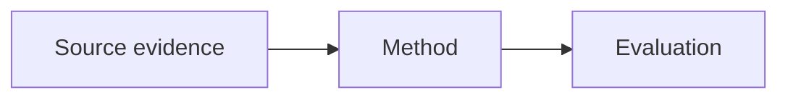

# Inline diagrams and charts

When a mechanism or comparison benefits from a visual, place a fenced `mermaid` or `chart` block in the ordinary Markdown answer/overview near the explanation. Both API and subscription-session results use the same renderer; no separate drawing API is required. Label a generated diagram as an explanatory aid, distinguish inferred structure, and cite supporting original pages immediately nearby. This is separate from `:::figure` markers, which display actual reviewed source crops.

Use small Mermaid flowcharts, sequence diagrams, stateDiagram-v2, class diagrams, mindmaps, or pie diagrams. Flowchart labels should be quoted. Plain labels in the reader's language work best. Do not add HTML, URLs, click handlers, style/classDef/linkStyle commands, configuration directives, external icons or images. The renderer accepts up to 16,000 characters, 180 lines and 150 edges; simplify instead of splitting an unreadable graph into arbitrary pieces.

Illustrative format (not a claim about a specific paper):



For numeric charts use strict JSON in a `chart` fence:

```chart
{"type":"bar","title":"Illustrative comparison","unit":"points","source":"Illustrative assumptions, not paper measurements","data":[{"label":"A","value":1},{"label":"B","value":2}]}
```

`type` is `bar` or `line`. Supply `title`, `unit`, `source` and 1–24 uniquely labelled finite numeric points. Lines require meaningfully ordered data. Cite the source page and preserve units and reported values. Never invent measured results to fill a chart; use a qualitative diagram if data are missing. Users can inspect the data table and source code, enlarge diagrams, and hover/focus data points. Markdown/standalone exports may retain these fences as source code rather than rendered images.

For source previews, use `[semantic label](#page=N "short exact original-language excerpt")`. N is the one-based PDF page index. The reader checks a unique normalized match before highlighting, previews the original source on hover/focus and clears jump highlighting after six seconds. Keep quote titles under 500 characters, copied from the specified source page. Do not invent or translate anchor quotes. With only `[p.N]`, preview shows the page opening and cannot imply a particular passage was verified.
